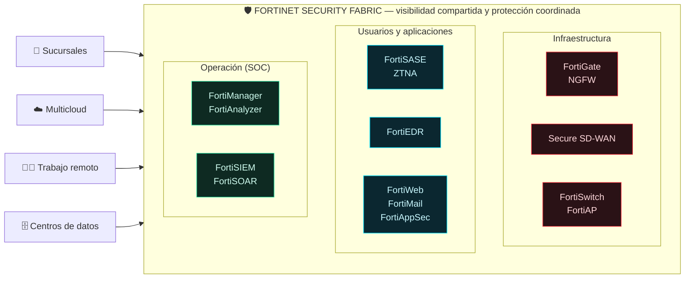

<p align="center">
  
</p>

<h1 align="center">🛡️ Fortinet Security Fabric — Pitch Deck Interactivo</h1>

<p align="center">
  <b>Dashboard SPA de alto impacto visual para una exposición ejecutiva de 5 minutos</b><br>
  <i>6 soluciones clave · Temporizador de pitch · Exportación para pre-socialización</i>
</p>

<p align="center">
  <a href="https://mrcastillof.github.io/fortinet-pitch-deck/"></a>
  
  
  
  
  
</p>

---

## 📣 En un minuto

> [!TIP]
> **Un solo archivo. Cero dependencias. Listo para el cliente.** Abre `index.html`, pulsa ▶ y deja que el reloj guí tu pitch de 5 minutos mientras cada solución se enciende sola.

| 🚀 Qué lo hace especial | Detalle |
|:--|:--|
| ⭐ **Ficha estrella** | La **Seguridad Perimetral (FortiGate & SD-WAN)** — la más atractiva comercialmente — lidera el Minuto 1 con tratamiento visual exclusivo |
| ⏱️ **Pitch Mode** | Reloj regresivo de 05:00 que **resalta automáticamente** la ficha que toca (~50 s c/u) |
| 📤 **Pre-socialización** | Copia el resumen ejecutivo al portapapeles o descárgalo en `.md` en un clic |
| 🌍 **Cobertura COEM** | Selector de regiones por ficha (Central · Andina · Norte · Sur) incluido en la exportación |
| 📱 **Responsive** | 100% adaptable a desktop, laptop y tablet |

---

## 🎬 Modo de uso — El pitch de 5 minutos

<table>
<tr><td>

**1️⃣ Prepara** — Asigna regiones COEM con clic en los chips verdes de cada ficha.

</td><td>

**2️⃣ Lanza** — Pulsa **▶ Iniciar** justo antes de hablar. El reloj arranca.

</td></tr>
<tr><td>

**3️⃣ Presenta** — Cada tramo de ~50 s **enciende automáticamente** su ficha en rojo.

</td><td>

**4️⃣ Exporta** — Antes de la reunión, **Copiar Resumen** o **Descargar .md** para enviarlo al cliente.

</td></tr>
</table>

<p align="center">
  <b>▶ Iniciar</b> · <b>⏸ Pausar</b> (para preguntas) · <b>↺ Reiniciar</b> (para repetir)
</p>

---

## 🧩 Las 6 soluciones de alto valor

<table>
<tr>
<th width="48">#</th>
<th>Solución</th>
<th>Área</th>
<th>Por qué vende</th>
</tr>
<tr>
<td align="center"><code>1</code></td>
<td><b>⭐ FortiGate (NGFW) & Secure SD-WAN</b></td>
<td>🔴 Seguridad perimetral y conectividad</td>
<td><i>La puerta de entrada: inspección de tráfico + conectividad de sedes en una sola plataforma</i></td>
</tr>
<tr>
<td align="center"><code>2</code></td>
<td><b>FortiSASE & ZTNA</b></td>
<td>🔵 Acceso seguro y trabajo híbrido</td>
<td><i>Protege usuarios remotos verificando usuario y dispositivo, sin importar su ubicación</i></td>
</tr>
<tr>
<td align="center"><code>3</code></td>
<td><b>FortiEDR</b></td>
<td>🟣 Protección de endpoints</td>
<td><i>Prevención, detección y respuesta en equipos y cargas de trabajo</i></td>
</tr>
<tr>
<td align="center"><code>4</code></td>
<td><b>FortiManager & FortiAnalyzer</b></td>
<td>🟢 Gestión y operaciones (SOC)</td>
<td><i>Administración centralizada, correlación de eventos y respuesta automatizada</i></td>
</tr>
<tr>
<td align="center"><code>5</code></td>
<td><b>FortiSwitch & FortiAP</b></td>
<td>🟡 LAN y Wi-Fi</td>
<td><i>Conectividad cableada e inalámbrica integrada con la arquitectura de seguridad</i></td>
</tr>
<tr>
<td align="center"><code>6</code></td>
<td><b>FortiWeb, FortiAppSec Cloud & FortiMail</b></td>
<td>🟠 Aplicaciones y correo</td>
<td><i>Protección de apps web, API y correo frente a ataques</i></td>
</tr>
</table>

> [!IMPORTANT]
> **⭐ Ficha estrella:** la Seguridad Perimetral lleva badge, borde y degradado rojo propios, encabeza el Minuto 1 del Pitch Mode y aparece marcada como `SOLUCIÓN ESTRELLA` en todos los documentos exportados.

---

## 🏗️ La idea central — De productos aislados a una arquitectura integrada



<p align="center">
  <b>Infraestructura + Usuarios/Aplicaciones + Operación = una sola plataforma</b><br>
  <i>No se limita a vender firewalls.</i>
</p>

---

## 🗂️ Estructura de cada ficha

Cada tarjeta responde **4 preguntas** con contenido estrictamente derivado de la fuente oficial:

<table>
<tr>
<th width="27%">1️⃣ ¿Qué hace?</th>
<th width="27%">2️⃣ ¿A quién se vende?</th>
<th width="27%">3️⃣ ¿Su diferenciador?</th>
<th width="19%">4️⃣ ¿Región COEM?</th>
</tr>
<tr>
<td>Definición funcional precisa basada estrictamente en la fuente.</td>
<td>Sucursales distribuidas · trabajo remoto · multicloud · centros de datos · operaciones SOC.</td>
<td>Integración nativa bajo Security Fabric, respuesta automatizada y menos complejidad que los silos aislados.</td>
<td>Selector con clic: <b>Central · Andina · Norte · Sur</b> — se exporta con la selección.</td>
</tr>
</table>

---

## ✨ Funcionalidades

<table>
<tr>
<th width="50%">🎴 Visualizador de fichas</th>
<th width="50%">⏱️ Pitch Mode</th>
</tr>
<tr>
<td>

- Grid responsive con **hover elevado** y transiciones `cubic-bezier`
- **Iconografía SVG técnica** propia por solución
- **Microinteracciones**: chips con estado ✓, pulsos y glow

</td>
<td>

- Reloj regresivo **05:00** con alerta en el último minuto
- **Resaltado automático** de la ficha activa
- Controles **▶ ⏸ ↺** + barra de progreso total

</td>
</tr>
<tr>
<th width="50%">📤 Copiar Resumen Ejecutivo</th>
<th width="50%">⬇️ Descargar .md</th>
</tr>
<tr>
<td>

- Texto plano listo para **correo, Slack o WhatsApp**
- Incluye las 6 fichas + cobertura COEM asignada
- Fallback si el portapapeles está restringido

</td>
<td>

- Genera `Soluciones_Fortinet_Resumen.md`
- Tabla del ecosistema + fichas completas
- ⭐ Solución estrella marcada en el encabezado

</td>
</tr>
</table>

---

## 🎨 Diseño visual

<p align="center">
  
  
  
  
</p>

- **Estética:** Dark Mode premium con glow radial y grid sutil
- **Tipografía:** San Francisco / Inter / Roboto (font-stack nativo, sin descargas)
- **Responsive:** grilla autoajustable `auto-fit / minmax` + media queries

---

## 🚀 Despliegue

> [!NOTE]
> **GitHub Pages activo** — cada `git push` a `master` **republica solo** la web en < 1 minuto.

| 🌐 Producción | 📦 Repositorio |
|:--|:--|
| [**mrcastillof.github.io/fortinet-pitch-deck**](https://mrcastillof.github.io/fortinet-pitch-deck/) | [**MrCastilloF/fortinet-pitch-deck**](https://github.com/MrCastilloF/fortinet-pitch-deck) |

<details>
<summary>💻 <b>Uso local</b> (clic para desplegar)</summary>

```bash
git clone https://github.com/MrCastilloF/fortinet-pitch-deck.git
cd fortinet-pitch-deck
start index.html          # o doble clic en index.html
```
</details>

<details>
<summary>🔄 <b>Actualizar y republicar</b> (clic para desplegar)</summary>

```bash
git add index.html
git commit -m "feat: descripción del cambio"
git push origin master
```
✅ GitHub Pages reconstruye automáticamente — sin pasos adicionales.
</details>

<details>
<summary>🧱 <b>Tecnología y arquitectura</b> (clic para desplegar)</summary>

| Aspecto | Decisión |
|---|---|
| Formato | **Single-file** — todo en un único `index.html` |
| Frontend | HTML5 + CSS3 vanilla + JavaScript ES6 |
| Dependencias | **Cero** — sin framework, sin CDN, funciona offline |
| Build tools | **Ninguno** — sin Node.js, Webpack ni compilación |
| Publicación | `publish*.ps1` local, excluido del repo vía `.gitignore` |
</details>

---

## 📁 Estructura del repositorio

```
fortinet-pitch-deck/
├── 🎯 index.html                    # SPA completa (single-file, autocontenido)
├── 📖 README.md                     # Este archivo
├── 🖼️ assets/banner.svg             # Banner hero vectorial
├── 📋 Compromiso Presentacion.md    # Especificación del compromiso
├── 📄 Soluciones Fortinet.docx      # Documento fuente de referencia
└── 🚫 .gitignore                    # Excluye scripts publish*.ps1
```

---

## 🚫 Regla de información — cero alucinaciones

> [!WARNING]
> **NO se inventan especificaciones fuera de la información oficial** de la arquitectura Fortinet Security Fabric y del documento de referencia `Soluciones Fortinet.docx`.

✅ Definiciones, perfiles y diferenciadores provienen **textualmente** de la fuente.
✅ Las regiones COEM **no se inventan**: se asignan manualmente por ficha.
✅ Sin cifras, precios ni características técnicas inventadas.

---

<p align="center">
  <b>🛡️ Fortinet Security Fabric</b><br>
  <i>De productos aislados a una arquitectura integrada</i><br>
  <br>
  
  
  
</p>

<p align="center">
  <sub>Marcas: Fortinet, FortiGate, FortiSASE, ZTNA, FortiEDR, FortiManager, FortiAnalyzer, FortiSwitch, FortiAP, FortiWeb, FortiAppSec Cloud y FortiMail son marcas de Fortinet, Inc. · Material de presentación sin afiliación oficial.</sub>
</p>
